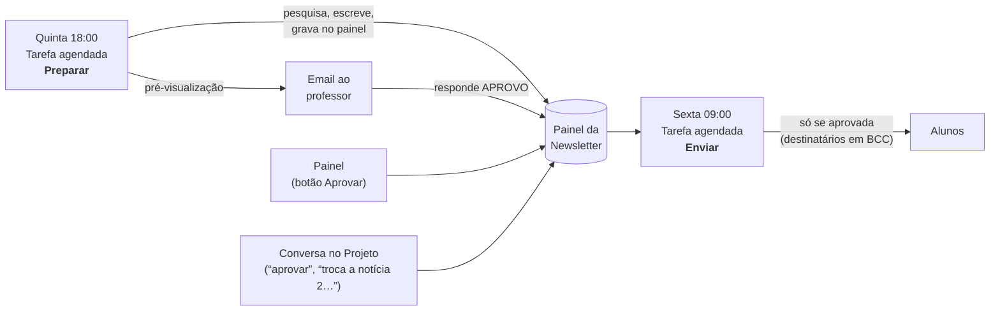

# AIAgent4Newsletter

Newsletter semanal por email sobre **Inteligência Artificial** e **IA na indústria automóvel**, preparada e enviada pelo Claude e gerida inteiramente a partir de uma conta Claude. Foi pensada para um professor que quer partilhar com os alunos de uma pós-graduação as 5 notícias da semana que valem a pena.

- **5 notícias por semana**: 3 de IA em geral ("IA no mundo") e 2 de IA no automóvel ("IA ao volante").
- **Número da semana** e uma pergunta **Para discutir** na aula.
- **Aprovação obrigatória**: nada chega aos alunos sem o professor aprovar.
- **3 templates** de email à escolha, que se podem trocar a qualquer momento.
- **Painel** para aprovar, gerir destinatários, trocar de template e pausar, e **gestão por conversa** no Projeto Claude.
- Pedidos de saída automáticos: quem responder **SAIR** é retirado da lista.

## Como funciona



1. **Quinta-feira às 18:00** a tarefa *Preparar* pesquisa as notícias dos últimos 7 dias, escreve a edição na template escolhida, grava-a no painel e envia uma pré-visualização ao professor.
2. O professor **aprova** de uma de três formas: responde **APROVO** ao email, carrega em **Aprovar** no painel, ou diz "aprovar" numa conversa do Projeto. Também pode pedir alterações ("troca a notícia 2 por algo sobre o AI Act") ou saltar a semana.
3. **Sexta-feira às 09:00** a tarefa *Enviar* envia a edição aprovada a todos os destinatários ativos, a partir do Gmail do professor. Se não estiver aprovada, não envia e avisa.

Dia e hora são configuráveis: basta pedir no Projeto ("muda o envio para segunda às 8h").

## O que é preciso

- Uma conta Claude com acesso a **Projetos**, **tarefas agendadas** e **artifacts** (confirme no seu plano).
- O **conector Gmail** ligado à conta Claude (é o Gmail que envia a newsletter).
- 15 minutos para a instalação.

## Instalação

### 1. Descarregar os ficheiros

Neste repositório, carregue em **Code › Download ZIP** e descomprima.

### 2. Criar o Projeto no Claude

1. Em claude.ai, crie um Projeto novo, por exemplo **"Newsletter IA"**.
2. Abra o ficheiro [`project-instructions.md`](project-instructions.md), copie tudo o que está abaixo da linha `---` e cole no campo **Instruções** do Projeto.
3. Adicione ao conhecimento do Projeto estes ficheiros (arraste-os):
   - `painel/painel.html`
   - `templates/briefing.html`, `templates/cartoes.html`, `templates/carta.html`
   - `tasks/preparar-edicao.md`, `tasks/enviar-edicao.md`
   - `docs/modelo-de-dados.md`, `docs/regras-editoriais.md`

### 3. Ligar o Gmail

Nas definições do Claude, em **Conectores**, ligue o **Gmail** com a conta a partir da qual quer enviar a newsletter.

### 4. Instalar

Abra uma conversa nova dentro do Projeto e escreva:

> **instala a newsletter**

O Claude vai perguntar o nome da newsletter, a assinatura, o seu email, o público e a template inicial. Depois, sozinho:

- publica o **Painel da Newsletter** na sua conta (privado, só você o vê);
- carrega as templates, as regras editoriais e os primeiros destinatários;
- cria as duas **tarefas agendadas** (*Newsletter IA — Preparar* e *Newsletter IA — Enviar*);
- oferece-se para preparar já uma edição de teste, enviada só para si.

### 5. Ativar a aprovação automática das tarefas

As tarefas agendadas correm sem ninguém a ver. Se a tarefa ficar à espera que alguém aprove cada ação (pesquisar, enviar email), nunca chega a terminar. Nas definições de cada tarefa agendada, ative **Aprovar automaticamente**, se a sua conta o permitir. O Claude diz-lhe no fim da instalação qual é o estado de cada tarefa.

> A tarefa *Enviar* nunca envia uma edição que não tenha sido aprovada por si. A aprovação automática só dispensa os pedidos de autorização técnicos.

## Usar no dia-a-dia

**No painel** (fica guardado nos seus artifacts):

| Separador | Para quê |
|---|---|
| Esta semana | Ver a edição, a pré-visualização do email, e **Aprovar**, **Pedir alterações** ou **Não enviar esta semana** |
| Destinatários | Adicionar emails (um a um ou colando uma lista), remover ou reativar |
| Template | Ver as 3 templates com a edição atual e escolher qual usar |
| Histórico | Todas as edições, estado e número de pessoas que receberam |
| Definições | Nome, assinatura, email do admin, público e preferências editoriais |

O botão **Pausar newsletter**, no topo, suspende tudo até carregar em **Retomar**.

**Por conversa** no Projeto, por exemplo:

- "mostra a edição desta semana"
- "aprovar"
- "troca a notícia 2 por algo sobre o AI Act"
- "a notícia 5 é antiga, procura outra"
- "aplica as alterações" (depois de pedir alterações no painel)
- "adiciona ana@exemplo.pt e rui@exemplo.pt à turma 2026"
- "quem recebe a newsletter?"
- "muda para a template Carta"
- "na template Cartões, muda a cor laranja para verde"
- "quero mais notícias sobre regulação europeia e menos sobre investimento"
- "pausa a newsletter até janeiro"
- "envia agora"
- "muda o envio para segunda às 8h"

## As 3 templates

| Template | Estilo | Quando escolher |
|---|---|---|
| **Briefing Executivo** (`briefing`) | Sóbria, uma coluna, título + resumo + "Porque importa" | Por defeito. Lê-se em 2 minutos. |
| **Cartões** (`cartoes`) | Visual, cabeçalho escuro, um cartão por notícia, imagem opcional | Para uma newsletter com mais presença visual. |
| **Carta** (`carta`) | Email pessoal, quase texto simples, assinado pelo professor | Melhor entregabilidade e mais respostas dos alunos. |

## Proteção de dados e boas práticas

- Os destinatários vão sempre em **BCC**: ninguém vê o email dos outros.
- Todas as edições têm no rodapé porque a pessoa recebe o email e como sair (responder **SAIR**). A tarefa *Preparar* processa estes pedidos todas as semanas.
- Adicione apenas pessoas que concordaram em receber a newsletter (por exemplo, alunos que o pediram na aula).
- Os dados ficam no painel, na sua conta Claude. Ninguém mais tem acesso, a não ser que partilhe o painel.

## Limitações

- O envio usa o Gmail da conta ligada. Para turmas de dezenas ou poucas centenas de pessoas funciona bem; o Gmail tem limites diários de envio, por isso não é adequado para listas grandes.
- A seleção das notícias depende da pesquisa web do Claude. A aprovação humana existe precisamente para apanhar erros: leia a pré-visualização antes de aprovar.
- Se o Gmail for desligado, as tarefas não conseguem enviar e registam o erro na edição.

## Estrutura do repositório

```
├── README.md                    este guia
├── project-instructions.md      instruções a colar no Projeto Claude
├── painel/painel.html           painel de gestão (publicado como artifact na instalação)
├── templates/                   briefing.html, cartoes.html, carta.html
├── tasks/                       prompts das duas tarefas agendadas
└── docs/
    ├── modelo-de-dados.md       como os dados estão organizados no painel
    └── regras-editoriais.md     critérios de seleção e de escrita das notícias
```

## Personalizar

- **Temas**: para mudar a divisão 3+2 ou acrescentar outro setor, peça no Projeto ("passa a ter 2 notícias gerais, 2 de automóvel e 1 de saúde") — o Claude atualiza as regras editoriais e as templates.
- **Regras editoriais**: o ficheiro `docs/regras-editoriais.md` é a versão inicial; depois da instalação, as regras em uso ficam no painel e podem ser ajustadas por conversa.

## Licença

MIT — ver [LICENSE](LICENSE).
